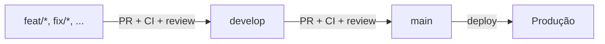

# 0002 - Estratégia de branches

## Contexto

Monolito mantido por um time pequeno. Precisamos de um fluxo simples, com uma branch estável para produção e uma de integração.

## Decisão

### Branches

| Branch | Papel | Deploy (Vercel) |
| --- | --- | --- |
| `main` | Código estável, sempre pronto para produção. | Produção |
| `develop` | Integração contínua das features; base para novas branches. | Preview (ambiente de homologação) |
| `feat/*`, `fix/*`, `docs/*`, `chore/*`, `refactor/*` | Trabalho de curta duração, uma tarefa por branch. | Preview por PR |

### Feature branches

- Criadas a partir de `develop`, com nome curto em minúsculas e hífens: `feat/busca-sessoes`, `fix/login-redirect`, `docs/arquitetura`.
- Vida curta: abrir PR assim que possível e remover a branch após o merge.
- Hotfix urgente: `fix/*` criada a partir de `main`, com PR para `main` e depois PR de `main` para `develop` para sincronizar.

### Fluxo de integração

1. Criar a feature branch a partir de `develop`.
2. Abrir PR para `develop`. O workflow `CI` deve passar e ao menos 1 pessoa deve aprovar.
3. Para release, abrir PR de `develop` para `main`, com o `CI` passando.
4. Merge na `main` com **merge commit**, preservando o histórico da release.

### Regras

- Não há push direto em `main` nem em `develop`; toda mudança entra por Pull Request.
- O merge só é liberado com o workflow `CI` aprovado (lint, `prisma validate` e build).
- Proteção de branch configurada nas settings do GitHub (ver `CONTRIBUTING.md`).

### Relação com o deploy

- Push/merge em `main` dispara deploy de **produção** na Vercel.
- Push em `develop` e PRs geram deploys de **preview**; o *Production Branch* da Vercel deve ser `main`.
- Variáveis de ambiente de produção e de preview são configuradas separadamente na Vercel.

## Consequências

- `main` reflete sempre o que está em produção.
- Mais uma etapa (PR de release) em troca de uma `main` estável e um ambiente de homologação.
